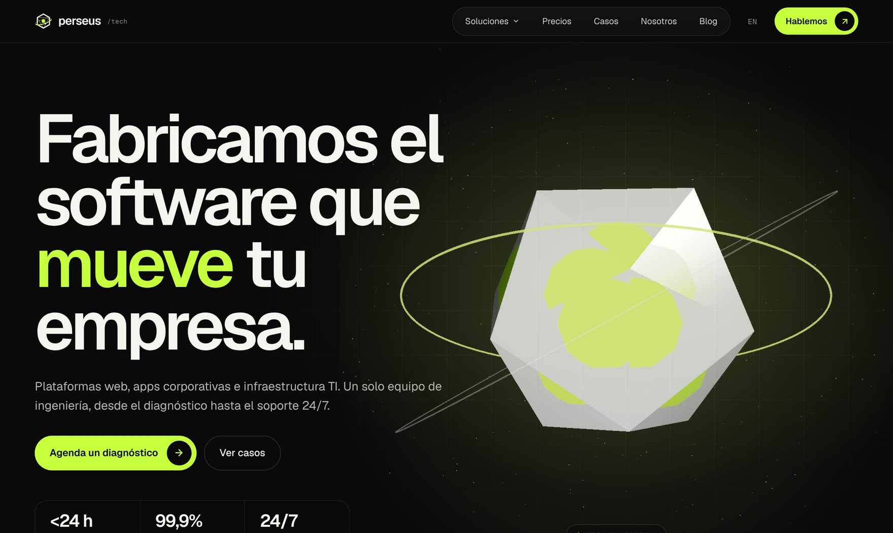
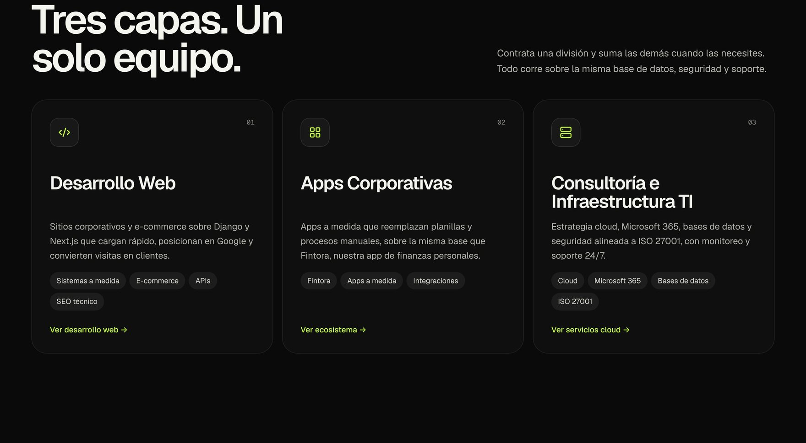
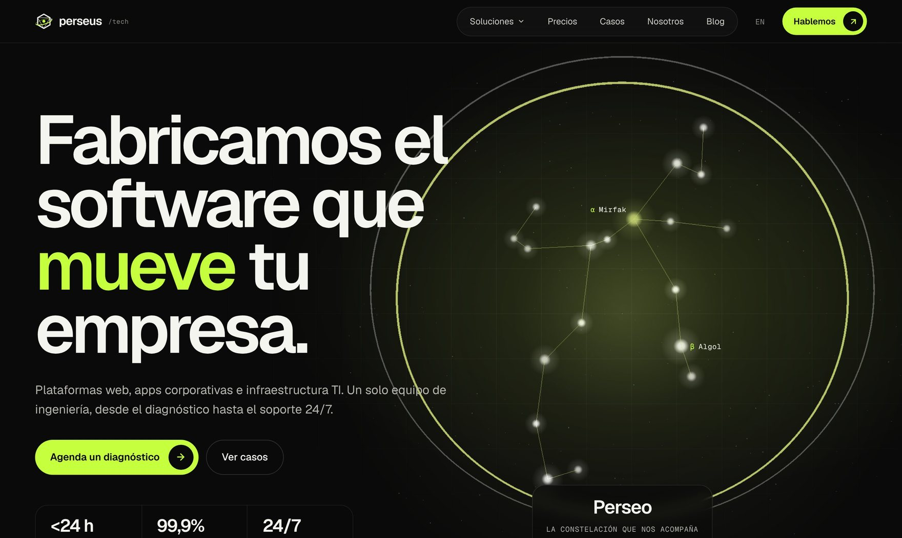
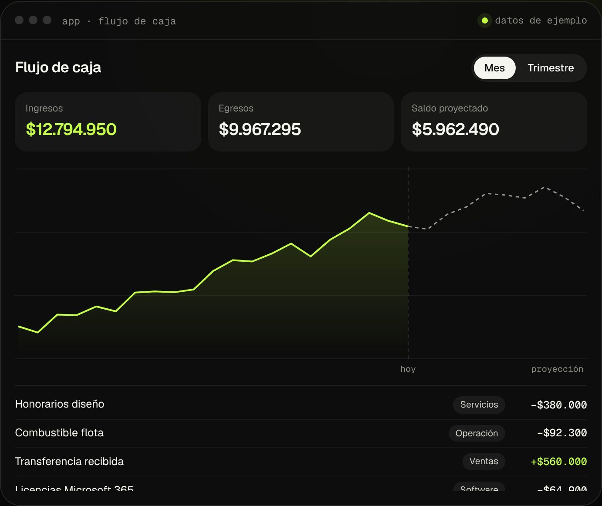
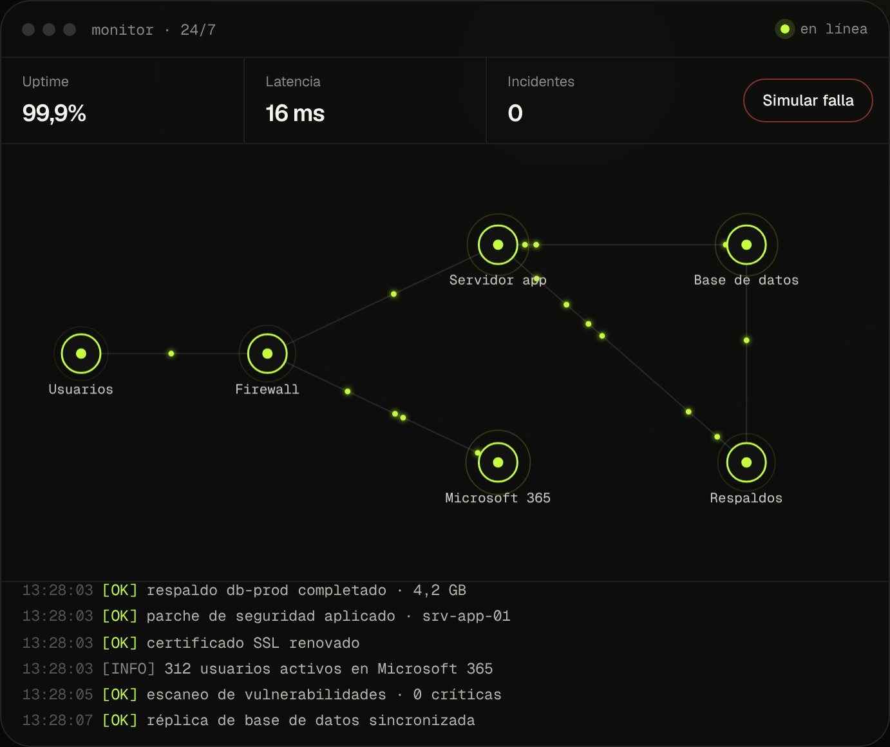
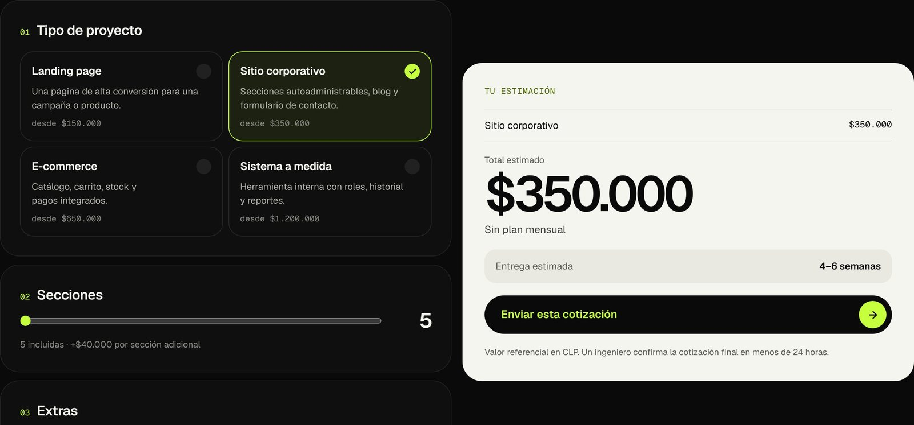
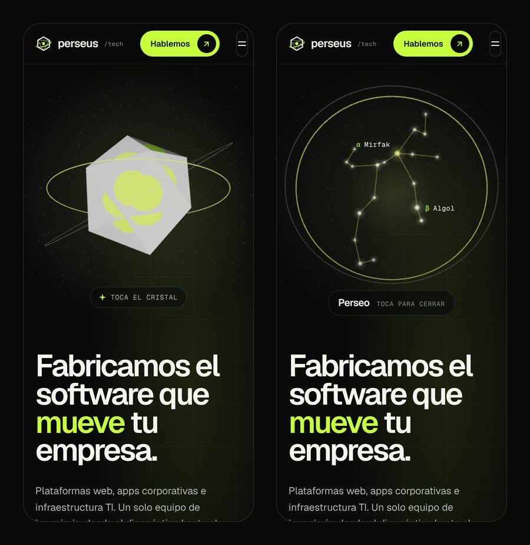

<p align="center">
  
</p>

<h1 align="center">Perseus Technology</h1>

<p align="center">
  <b>Fabricamos el software que mueve tu empresa.</b><br>
  Plataformas web, apps corporativas e infraestructura TI · Santiago, Chile
</p>

<p align="center">
  <a href="https://perseustechnology.dev"><b>perseustechnology.dev</b></a>
  &nbsp;·&nbsp;
  <a href="https://perseustechnology.dev/contacto/">Contacto</a>
  &nbsp;·&nbsp;
  <a href="https://perseustechnology.dev/en/">English</a>
</p>

<p align="center">
  <a href="https://github.com/lordPobre/PerseusTechnology/actions/workflows/ci.yml"></a>
  
  
  
  
</p>

---

## El sitio

Sitio corporativo de Perseus Technology, empresa chilena de ingeniería de software e infraestructura TI. Presenta las tres divisiones de la empresa, los casos reales, el blog y un cotizador en línea, en español e inglés.

| 01 · Desarrollo Web | 02 · Apps Corporativas | 03 · Consultoría e Infraestructura TI |
| --- | --- | --- |
| Sitios corporativos y e-commerce sobre Django y Next.js que cargan rápido y posicionan en Google. | Apps a medida que reemplazan planillas y procesos manuales, sobre la misma base que Fintora. | Estrategia cloud, Microsoft 365, bases de datos y seguridad alineada a ISO 27001, con soporte 24/7. |

<p align="center">
  
</p>

---

## Lo que hace distinto al sitio

### Un cristal que se abre en una constelación

<p align="center">
  
</p>

El objeto del hero es una escena 3D en three.js: un cristal de vidrio con un núcleo verde, dos anillos y polvo de estrellas que sigue al cursor. **Al tocarlo se abre**: sus 20 caras se separan, el núcleo se apaga y de ese punto nace **Mirfak**, la estrella más brillante de Perseo, que viaja a su lugar mientras la figura se dibuja hacia afuera.

- **Cielo real.** Las 19 estrellas principales de Perseo están ubicadas con sus coordenadas J2000 del Yale Bright Star Catalogue. **Algol**, la estrella variable, parpadea cada pocos segundos.
- **Accesible.** Se enfoca con Tab, se abre con Enter o Espacio y se cierra con Escape. El lector de pantalla anuncia el estado.
- **Liviano cuando hace falta.** Sin GPU, con ahorro de datos o con movimiento reducido, se muestra la misma constelación en SVG. three.js se descarga recién después de cargar la página, la escena solo se dibuja cuando está en pantalla y baja su resolución si el equipo no sostiene la animación.

### Demos en vivo en cada servicio

<table>
  <tr>
    <td width="50%"></td>
    <td width="50%"></td>
  </tr>
  <tr>
    <td><b>Apps Corporativas</b> · panel de flujo de caja con datos de ejemplo.</td>
    <td><b>Consultoría TI</b> · monitor de infraestructura; al tocar un nodo se simula una falla.</td>
  </tr>
</table>

Cada página de servicio tiene una demo interactiva en lugar de una captura estática. **Desarrollo Web** muestra código Django que construye un sitio en vivo, línea por línea. **Fintora**, la app de finanzas personales de Perseus, tiene su propio orbe interactivo. Todas son Web Components escritos a mano, sin frameworks ni dependencias.

### Cotizador y contacto en pasos

<p align="center">
  
</p>

El cotizador calcula en el momento un valor referencial en pesos y un plazo de entrega según el tipo de proyecto, las secciones, los extras y el plan de soporte. Con un clic la cotización pasa al formulario de contacto, que guía en tres pasos (necesidad, detalles y datos) y muestra el resumen de la solicitud mientras se completa.

### En el celular

<p align="center">
  
</p>

---

## Bajo el capó

| Capa | Tecnología |
| --- | --- |
| Backend | Django 6 · PostgreSQL · plantillas de Django |
| Interfaz | Tailwind compilado · Alpine.js · Web Components propios · fuentes Geist locales |
| 3D | three.js 0.160 (cristal y constelación) |
| Contenido | Admin de Django: casos, blog, tecnologías e imágenes del sitio en Cloudinary |
| Idiomas | Español e inglés con i18n de Django, `hreflang` y sitemap con versiones alternativas |
| Correo | SMTP de Zoho: aviso interno y confirmación al cliente |
| Hosting | Vercel · estáticos con WhiteNoise y caché en el CDN |

### Rendimiento

- CSS crítico dentro del HTML: la página se pinta sin esperar hojas de estilo.
- Estáticos con hash y comprimidos, guardados un año en el navegador y en el CDN.
- El 3D y Google Analytics se cargan después de la primera pintura o con la primera interacción.
- Navegación con *Speculation Rules*: la siguiente página se precarga antes del clic.
- Imágenes de Cloudinary con formato y calidad automáticos según el dispositivo.
- Datos estructurados (JSON-LD), sitemap y `robots.txt` para buscadores.

### Seguridad

- Cabeceras de producción: HSTS, Content-Security-Policy con nonce, cookies seguras y protección contra *clickjacking*.
- Formulario de contacto con validación en el servidor, defensas contra bots y límites de envío. Cada solicitud queda guardada antes de enviar el correo, así no se pierde aunque falle el SMTP.
- Admin con ruta configurable y bloqueo automático ante intentos de acceso por fuerza bruta.
- Dependencias revisadas en cada cambio y actualizaciones automáticas con Dependabot.

¿Encontraste un problema de seguridad? Escríbenos desde [la página de contacto](https://perseustechnology.dev/contacto/) en lugar de abrir un issue público.

### Calidad

Cada push corre el [CI](.github/workflows/ci.yml): revisión de configuración de producción (falla con cualquier advertencia), migraciones al día, traducciones, recolección de estáticos (detecta archivos que una plantilla nombra y no existen), pruebas automáticas y auditoría de vulnerabilidades con `pip-audit`.

---

## Estructura

```
config/                 settings, urls y wsgi
core/
├── contenido.py        textos de las divisiones, productos y cotizador
├── models.py           casos, blog, tecnologías, imágenes del sitio y contactos
├── seguridad.py        defensas del formulario y límites de envío
├── views.py
├── templatetags/       imágenes de Cloudinary, CSS en línea, sello de formularios
├── templates/          páginas, parciales, correos, 404 y 500
└── static/core/js/     perseus-glass · perseus-live · perseus-forms · fintora-orb
locale/en/              traducción al inglés
tailwind/               entrada de Tailwind
.github/                CI y Dependabot
```

## Desarrollo local

```powershell
python -m venv venv
venv\Scripts\activate
pip install -r requirements.txt
python manage.py migrate
python manage.py runserver
```

`.env` mínimo para trabajar en local:

```
DEBUG=True
SECRET_KEY=cualquier-valor-local
```

Sin `DEBUG=True` el sitio arranca en modo producción: redirige a HTTPS y exige `SECRET_KEY`. Sin `DATABASE_URL` usa SQLite.

```powershell
python manage.py test                       # pruebas (siempre en SQLite local)
python manage.py collectstatic --noinput    # estáticos con hash, como en producción
python manage.py makemessages -l en         # después de agregar textos con 
python manage.py compilemessages
.\tailwindcss.exe -i tailwind\input.css -o core\static\core\css\tailwind.css --minify
```

## Variables de entorno

| Variable | Obligatoria | Uso |
| --- | --- | --- |
| `SECRET_KEY` | Sí | Clave larga y aleatoria: `python -c "import secrets; print(secrets.token_urlsafe(64))"` |
| `DATABASE_URL` | Sí | PostgreSQL de producción |
| `EMAIL_HOST_USER`, `EMAIL_HOST_PASSWORD` | Sí | Cuenta de Zoho que envía los correos del formulario |
| `CLOUDINARY_CLOUD_NAME`, `CLOUDINARY_API_KEY`, `CLOUDINARY_API_SECRET` | Sí | Imágenes administradas desde el admin |
| `ADMIN_URL` | No | Ruta del admin |
| `ALLOWED_HOSTS`, `CSRF_TRUSTED_ORIGINS` | No | Listas separadas por comas |
| `CSP_ENFORCE` | No | `True` para que la CSP bloquee en vez de solo reportar |
| `CLIENT_IP_HEADER` | No | Cabecera con la IP real del visitante: `HTTP_X_REAL_IP` por defecto, `HTTP_CF_CONNECTING_IP` con Cloudflare |

## Despliegue

Vercel construye el sitio en cada push a `main` con `build_files.sh`: instala dependencias, recolecta los estáticos y aplica las migraciones. Las ramas de Dependabot no se despliegan; se revisan con el CI y se fusionan cuando pasan.

---

## Autor

**Carlos López Figueroa** · fundador e ingeniero de Perseus Technology · [lordPobre](https://github.com/lordPobre)

© 2026 Perseus Technology. Todos los derechos reservados. El repositorio es público como portafolio; el código no tiene una licencia de uso abierto.

<details>
<summary><b>In English</b></summary>
<br>

Corporate website of **Perseus Technology**, a software engineering and IT infrastructure company based in Santiago, Chile. Built with Django 6, compiled Tailwind and hand-written Web Components, fully bilingual (Spanish/English).

Highlights: a three.js glass crystal in the hero that opens into the **Perseus constellation**, plotted from real J2000 star coordinates, with an accessible SVG fallback; live interactive demos on every service page; a real-time quote calculator; production security headers with a nonce-based CSP, bot-resistant contact form and brute-force protection for the admin; and a CI pipeline that checks deployment settings, migrations, translations, static files, tests and known vulnerabilities on every push.

</details>
